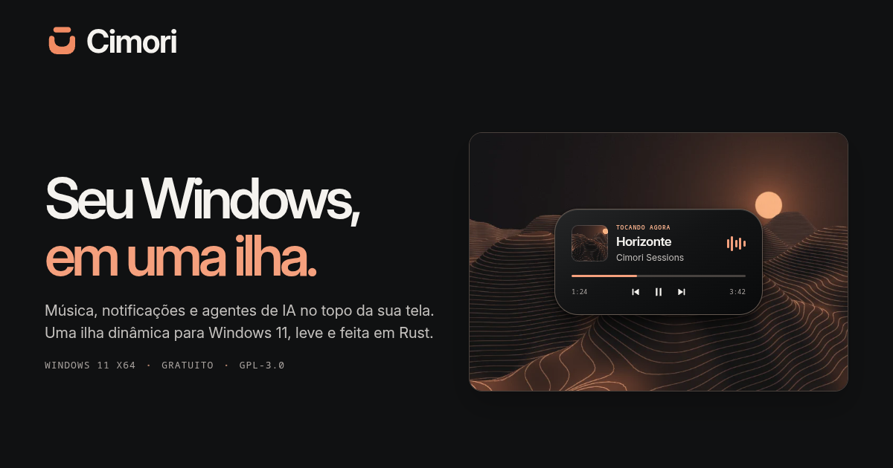
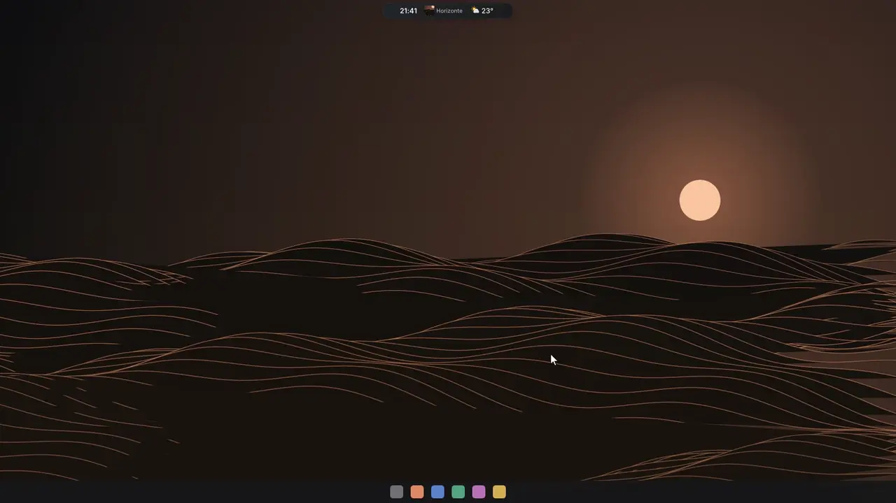
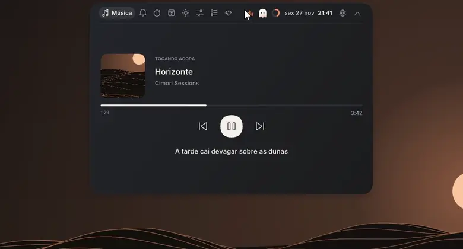
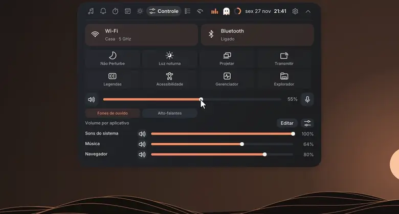
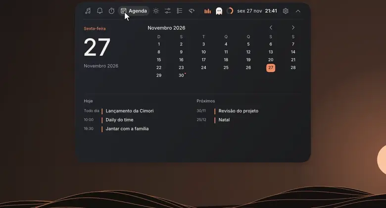
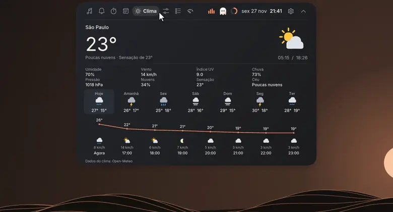
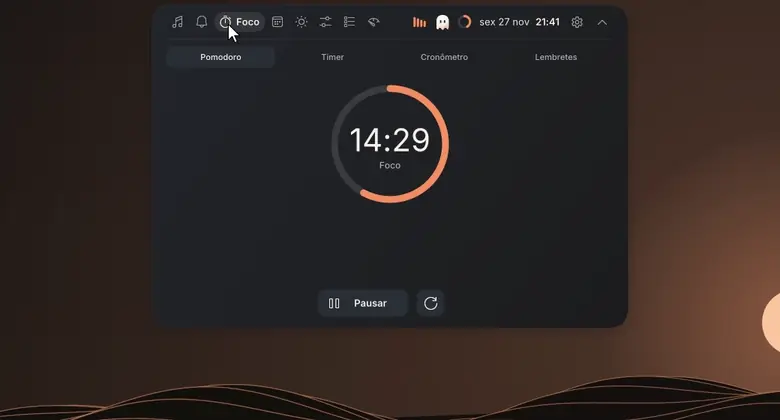
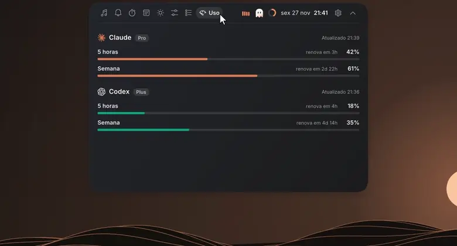
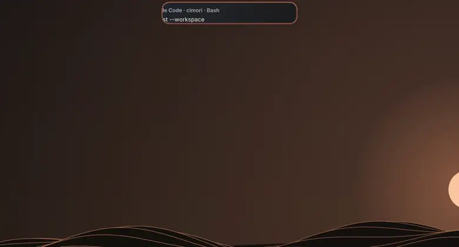
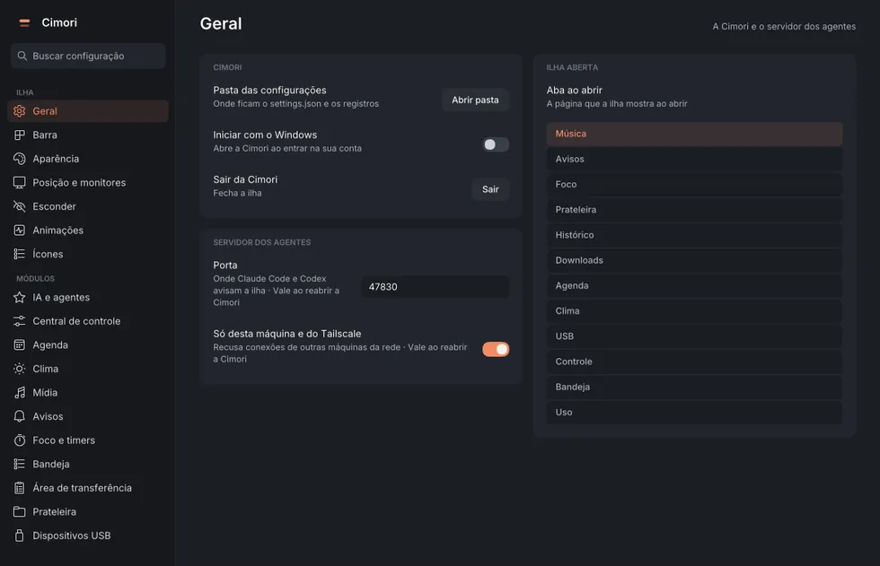

<div align="center">



**A dynamic island for Windows 11.** Your music, notifications, calendar, timers and AI agents in a pill
at the top of the screen, which opens into panels with a click.

[](https://github.com/Vini-Paixao/Cimori/releases/latest)
[](https://github.com/Vini-Paixao/Cimori/releases)


[](LICENSE)

**English** · [Português (Brasil)](README.pt-BR.md)



[](https://github.com/Vini-Paixao/Cimori/releases/latest)

</div>

Cimori turns the middle of the top of your screen into a black pill. Closed, it shows the time, what is
playing, the weather or your next event. Click it (or just rest the mouse on it, if you prefer) and it
opens with spring physics into a panel with a tab for each thing. Windows notifications, permission
requests from Claude Code and Codex and a finished download show up in the same place instead of in a
corner of the screen. And through the mascot you chat with Claude Code, Codex or OpenCode Go, with the
model you pick, right from the island.

It is free software (GPL-3.0), written in Rust, with no Electron and no embedded browser: light on RAM
and CPU. It was born from two free projects, [isle](https://github.com/zickrian/isle) by zickrian and
[Mac Island & Dock](https://windhawk.net/mods/mac-island-dock) by caliberda.

> The interface speaks English and Brazilian Portuguese, following Windows (Settings → General →
> Language). Want it in yours? See [Adding a language](locales/README.md).

## Contents

- [What it does](#what-it-does)
- [Download and install](#download-and-install)
- [Usage](#usage)
- [AI agents (hooks)](#ai-agents-hooks)
- [Windhawk bridge (optional)](#windhawk-bridge-optional)
- [Privacy](#privacy)
- [Development](#development)
- [Credits and licenses](#credits-and-licenses)

## What it does

<table>
<tr>
<td width="44%"><b>Music.</b> Whatever any Windows player is playing (Spotify, the browser, any app that uses the media controls), with cover art, controls, a progress bar and synced lyrics. The closed pill shows the song, and the bars at the top of the panel move while it plays.</td>
<td width="56%"></td>
</tr>
<tr>
<td width="44%"><b>Control center.</b> Wi-Fi, Bluetooth and shortcuts such as Do Not Disturb, Night light and Project; the volume (the mouse wheel on the pill changes it too), the microphone, the audio output and each app's volume. Edit the shortcuts as on an iPhone.</td>
<td width="56%"></td>
</tr>
<tr>
<td width="44%"><b>Calendar.</b> The month and the day's events from Google or Outlook (through the .ics address), with holidays and reminders. The pill can count down to your next event.</td>
<td width="56%"></td>
</tr>
<tr>
<td width="44%"><b>Weather.</b> Now, hour by hour and the next days, from Open-Meteo, for your city.</td>
<td width="56%"></td>
</tr>
<tr>
<td width="44%"><b>Focus.</b> Pomodoro, timer, stopwatch and reminders. The time left shows on the closed pill.</td>
<td width="56%"></td>
</tr>
<tr>
<td width="44%"><b>AI: usage and assistant.</b> How much of Claude and Codex you have used (the 5-hour session and the week) and when it resets, also as rings at the top of the panel.</td>
<td width="56%"></td>
</tr>
<tr>
<td width="44%"><b>Chat with your agents.</b> The mascot at the top of the panel opens a chat with Claude Code, Codex or OpenCode Go, through the programs and sign-ins you already have. Pick each one's model (click the agent's tab again, or in the settings) and ask for anything: the answer streams in. When the AI wants to run something on your PC, it shows the whole command on a card, and it runs only after you click Executar (Run).</td>
<td width="56%"></td>
</tr>
<tr>
<td width="44%"><b>Agents on the island.</b> When Claude Code or Codex asks for permission, the island grows into a card with the command and you answer right there: Allow, Always or Deny. When they finish, a banner drops out of the pill.</td>
<td width="56%"></td>
</tr>
<tr>
<td width="44%"><b>Windows notifications.</b> They drop out of the pill as banners (you can reply to messages right there), and the bell keeps the list, page by page, with muted apps.</td>
<td width="56%"></td>
</tr>
</table>

**And also:** clipboard history; a file shelf that takes files from your phone over the local network
(QR code); USB drives; downloads, with the pill filling up while they run; the other apps' tray icons;
a pill or a notch, Liquid Glass, an accent color and icon packs (Fluent, Lucide, Tabler, Phosphor and
more); an island on every monitor; stepping aside over the apps you pick and over full-screen games and
videos; tabs in your own order; and updates from the island itself, checking the installer's SHA-256.

> The clips above are drawn by Cimori's own renderer, with sample data, on a made-up desktop: none of
> them is a capture of anyone's screen. To make them again: `.\scripts\readme-media.ps1`.

## Download and install

Requirements: **Windows 11**, 64-bit (Windows 10 may work, with no guarantee). For the agents,
[Claude Code](https://claude.com/claude-code) and/or Codex installed. Optional: [Windhawk](https://windhawk.net),
for the tray and download-progress bridge.

[Releases](https://github.com/Vini-Paixao/Cimori/releases/latest) has two downloads:

- **Installer** (`Cimori-<version>-setup.exe`, recommended): installs for your user only, without
  asking for administrator rights, in `%LOCALAPPDATA%\Programs\Cimori`, with a Start menu shortcut. To
  update, run the new version's installer over it (or use **Configurações → Atualizações**); to remove
  it, use **Windows Settings → Apps** (the agents' hooks go with it; your settings stay).
- **Portable** (`Cimori-<version>-win-x64.zip`): extract it to a folder of yours and open `Cimori.exe`.

The release's `SHA256SUMS.txt` checks the downloaded files. Windows SmartScreen may warn the first time,
because the executable is not signed: click "More info" and "Run anyway".

The first time, a **welcome** guide helps you pick a style and a color, install the agents' hooks with
one click and set up the Windhawk bridge. To start with Windows, turn on **Configurações → Geral →
Iniciar com o Windows**. Settings live in `%APPDATA%\Cimori\settings.json` (with the `Cimori.log` log
next to it).

## Usage

| Do this | To |
|---|---|
| Click the pill | Open the panel (or just rest the mouse on it, with **Abrir painel ao passar o mouse** on) |
| Click a tab at the top | Switch pages |
| Move the mouse away, or click the ↑ arrow | Close it (with **Seta fixa a ilha aberta** on, the arrow keeps the panel open until you click it again) |
| Right-click the island, or click the gear | Open the settings |
| Mouse wheel on the closed pill | Change the volume (or the track, if you turn that on for the song) |
| Drag a file to the pill | Keep it on the shelf (with the Shelf module on) |
| A keyboard shortcut of yours | Minimize and restore the island, or open the notifications (**Configurações → Atalhos**) |

Almost everything is in the settings, a window of its own with search: which modules show and in what
order, what the closed pill shows (and the clock in the middle), the look, the chat's models, which
monitors get an island and which apps it steps aside for.

<div align="center">

</div>

## AI agents (hooks)

In **Configurações → IA e agentes → Instalar os hooks** (or in the welcome guide), Cimori adds its hooks
to Claude Code's `~/.claude/settings.json` and Codex's `~/.codex/hooks.json`. The hooks call
`Cimori.exe` itself, which talks to the island over `127.0.0.1:47830` with a shared token. **Remover os
hooks** removes only Cimori's. From the command line: `Cimori.exe --install-hooks` and
`Cimori.exe --uninstall-hooks`. If you move `Cimori.exe` to another folder, it points the hooks at the
new place the next time it opens.

## Windhawk bridge (optional)

Windows only hands the tray icons and the taskbar's progress to Explorer itself. The bridge is a small
Windhawk mod that reads them inside Explorer and passes them to Cimori. With it, the island shows and
clicks every tray icon and fills the pill while files download.

1. Install [Windhawk](https://windhawk.net).
2. In Windhawk, click **Create a new mod**.
3. Delete the sample code and paste all of `cimori-tray-bridge.wh.cpp` (it comes in the zip; the welcome
   guide has a **Copiar código da ponte** button).
4. **Compile Mod**, then **Exit Editing Mode**: the mod is on.

Technical details in [`windhawk/README.md`](windhawk/README.md). Without the bridge, Cimori works just
the same.

## Privacy

Cimori has no account, no telemetry and no server of its own. It only goes online for:

| What | Where | When |
|---|---|---|
| Weather and city search | Open-Meteo (`api.open-meteo.com`, `geocoding-api.open-meteo.com`) | Weather module on, every 30 min |
| Song lyrics | lrclib.net | "Letras" on, for each new track |
| Holidays | Nager.Date (`date.nager.at`) | "Feriados" on |
| Your calendar | The .ics address you paste | Calendar module with an address |
| Icon packs | jsDelivr (`cdn.jsdelivr.net`) | Once, when you pick an online pack |
| Updates | GitHub (`api.github.com`) | On start and once a day; can be turned off |
| Installing a new version | GitHub (`github.com` and the installer download) | Only when you click "Baixar e instalar" |
| Claude sign-in | `platform.claude.com`, with Claude Code's sign-in | "Renovar o login do Claude sozinha" on, when it expires |
| Agents' quotas | `api.anthropic.com`, `chatgpt.com`, with the sign-in Claude Code and Codex already have | AI module on |

The AI chat runs the `claude`, `codex` or `opencode` programs installed on your computer. The hooks
server and the shelf's QR sharing stay on your local network.

## Development

Needs stable [Rust](https://rustup.rs) (1.88 or newer) and the Visual Studio Build Tools (MSVC), on
Windows:

```powershell
git clone https://github.com/Vini-Paixao/Cimori
cd Cimori
cargo build --release          # target\release\Cimori.exe
cargo test --workspace
.\scripts\release.ps1          # dist\: the portable zip and, with Inno Setup 6, the installer
.\scripts\readme-media.ps1     # docs\media\: this README's video and clips (needs ffmpeg)
```

**Languages.** Every text lives in [`locales/`](locales/), one file per language; a test checks that
they all have the same keys. [Adding a language](locales/README.md) takes one file and one line of
code. `.\scripts\readme-media.ps1 -Lang en-US` draws the video and clips in English.

**Releasing.** Once CI passes on `main`, GitHub Actions publishes the Windows x64 installer, the
portable ZIP and `SHA256SUMS.txt`. The version moves up a patch from the highest published tag (from
`1.0.2` to `1.0.3`, say). To start a new series, open **Actions → CI → Run workflow**, pick `main` and
enter a higher version such as `2.0.0`. To rebuild a published version, check out its tag and run
`.\scripts\release.ps1 -Version 2.0.0 -RequireInstaller` with Inno Setup 6.

## Credits and licenses

- **Cimori**: Marcus Paixão, [GPL-3.0](LICENSE).
- **[isle](https://github.com/zickrian/isle)**: zickrian, GPL-3.0. The base of the island, the agents,
  the Pomodoro and many modules (`crates/isle-core` carries parts ported unchanged).
- **[Mac Island & Dock](https://windhawk.net/mods/mac-island-dock)**: caliberda, GPL-3.0. The Windhawk
  mod the options, modules, notch, control center and bridge come from.
- **Icon packs** (downloaded only when picked): Fluent UI System Icons (Microsoft), Ionicons, Tabler,
  Phosphor, Bootstrap Icons, Iconoir and Heroicons (Tailwind Labs), MIT; Lucide, ISC; Material Symbols
  (Google), Apache 2.0.
- **Rust libraries**: tokio, reqwest, serde, tiny-skia, resvg, ab_glyph, windows-rs and others, each
  under its own license (MIT, Apache 2.0 and similar); the full list is in `Cargo.lock`.
