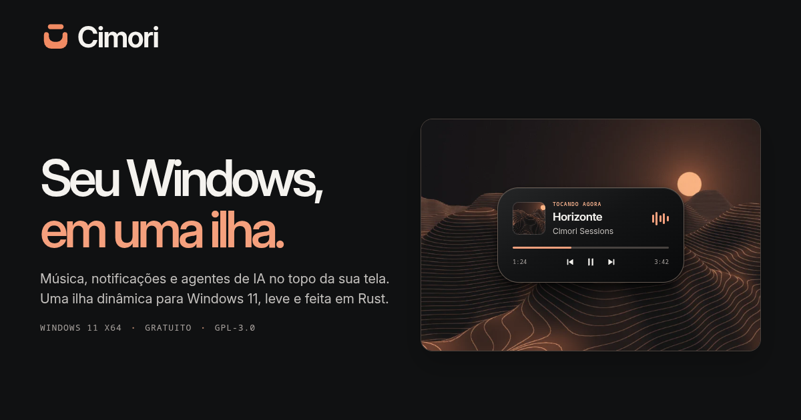
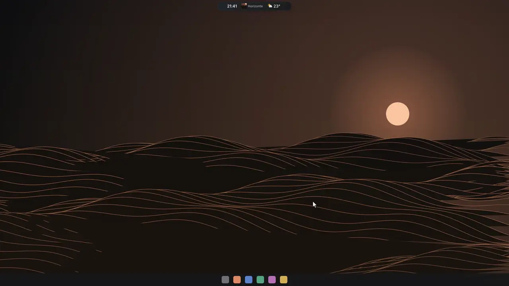
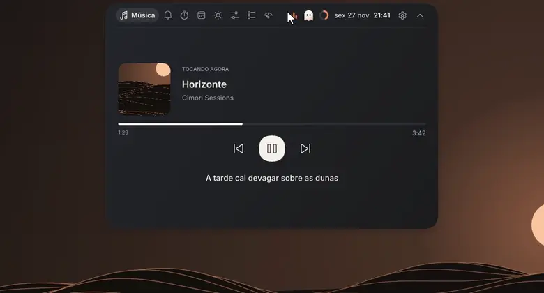
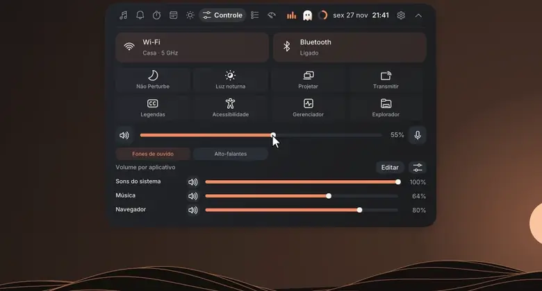
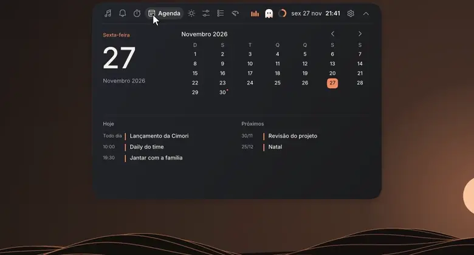
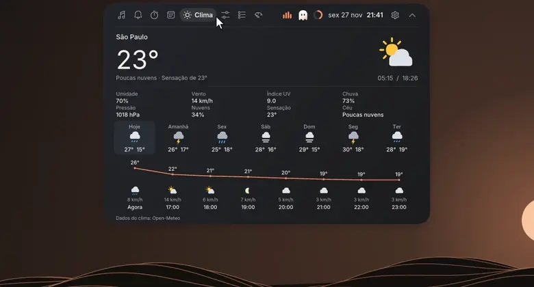
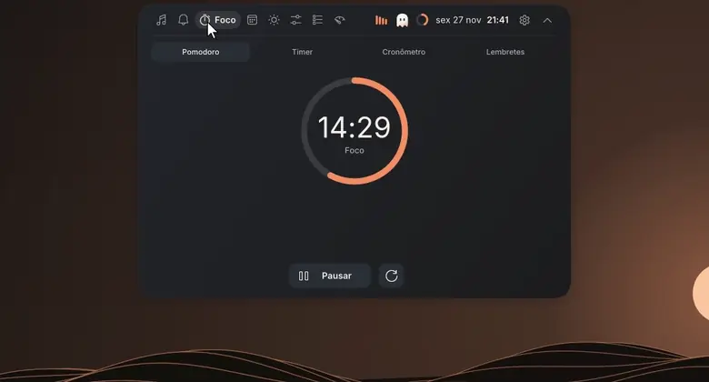
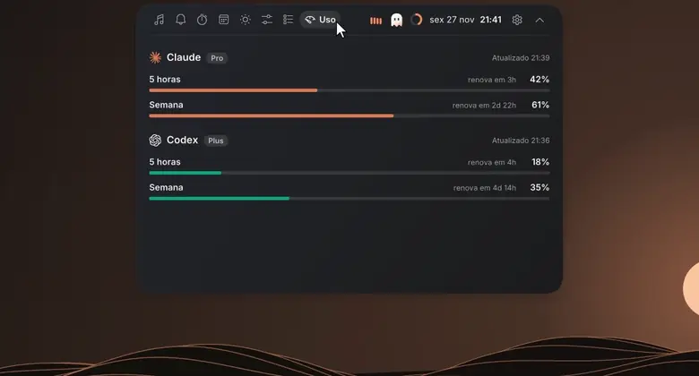
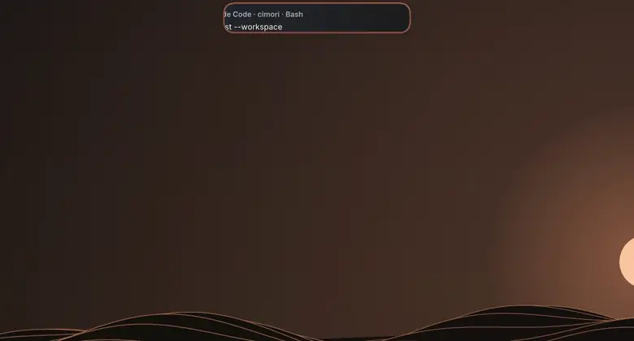
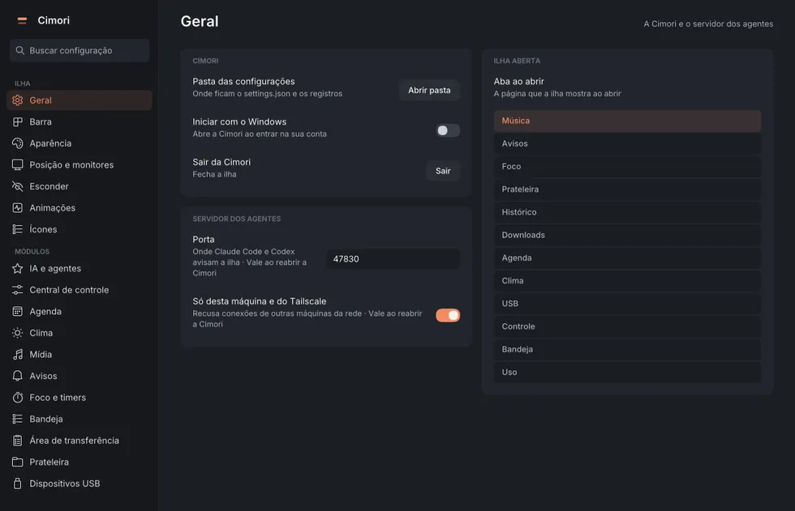

<div align="center">



**Uma ilha dinâmica para o Windows 11.** Música, avisos, agenda, timers e os seus agentes de IA numa
pílula no topo da tela, que abre em painéis com um clique.

[](https://github.com/Vini-Paixao/Cimori/releases/latest)
[](https://github.com/Vini-Paixao/Cimori/releases)


[](LICENSE)

[English](README.md) · **Português (Brasil)**



[](https://github.com/Vini-Paixao/Cimori/releases/latest)

</div>

A Cimori transforma o meio do topo da tela numa pílula preta. Fechada, ela mostra a hora, o que está
tocando, o clima ou o próximo compromisso. Um clique (ou só o mouse em cima, se você preferir) e ela se
abre, com física de mola, num painel com uma aba para cada coisa. Avisos do Windows, pedidos de
permissão do Claude Code e do Codex e o fim de um download aparecem no mesmo lugar, e não no canto da
tela. E, pelo mascote, você conversa com o Claude Code, o Codex ou o OpenCode Go, com o modelo que
escolher, direto da ilha.

É software livre (GPL-3.0), escrito em Rust, sem Electron e sem navegador embutido: leve em RAM e CPU.
Nasceu da união de dois projetos livres, o [isle](https://github.com/zickrian/isle) de zickrian e o
[Mac Island & Dock](https://windhawk.net/mods/mac-island-dock) de caliberda.

> A interface fala português do Brasil e inglês, seguindo o Windows (Configurações → Geral →
> Idioma). Quer no seu idioma? Veja [Adicionar um idioma](locales/README.md).

## Sumário

- [O que ela faz](#o-que-ela-faz)
- [Baixar e instalar](#baixar-e-instalar)
- [Como usar](#como-usar)
- [Agentes de IA (hooks)](#agentes-de-ia-hooks)
- [Ponte do Windhawk (opcional)](#ponte-do-windhawk-opcional)
- [Privacidade](#privacidade)
- [Desenvolvimento](#desenvolvimento)
- [Créditos e licenças](#créditos-e-licenças)

## O que ela faz

<table>
<tr>
<td width="44%"><b>Música.</b> O que toca em qualquer player do Windows (Spotify, o navegador, qualquer app que use os controles de mídia), com capa, controles, barra de progresso e letra sincronizada. A pílula fechada mostra a música, e as barrinhas no topo do painel dançam enquanto ela toca.</td>
<td width="56%"></td>
</tr>
<tr>
<td width="44%"><b>Central de controle.</b> Wi-Fi, Bluetooth e atalhos como Não Perturbe, Luz noturna e Projetar; o volume (a roda do mouse na pílula também muda), o microfone, a saída de áudio e o volume de cada aplicativo. Os atalhos se editam como no iPhone.</td>
<td width="56%"></td>
</tr>
<tr>
<td width="44%"><b>Agenda.</b> O calendário do mês e os compromissos do dia, do Google ou do Outlook (pelo endereço .ics), com feriados e lembretes. A pílula pode contar o tempo até o próximo compromisso.</td>
<td width="56%"></td>
</tr>
<tr>
<td width="44%"><b>Clima.</b> Agora, de hora em hora e os próximos dias, pelo Open-Meteo, para a sua cidade.</td>
<td width="56%"></td>
</tr>
<tr>
<td width="44%"><b>Foco.</b> Pomodoro, timer, cronômetro e lembretes. O tempo que falta aparece na pílula fechada.</td>
<td width="56%"></td>
</tr>
<tr>
<td width="44%"><b>IA: uso e assistente.</b> Quanto você já usou do Claude e do Codex (a sessão de 5 horas e a semana) e quando renova, também em anéis no topo do painel.</td>
<td width="56%"></td>
</tr>
<tr>
<td width="44%"><b>Converse com os seus agentes.</b> O mascote no topo do painel abre um chat com o Claude Code, o Codex ou o OpenCode Go, pelos programas e logins que você já tem. Escolha o modelo de cada um (clique de novo na aba do agente, ou em Configurações → IA e agentes) e peça o que quiser: a resposta chega aos poucos. Quando a IA quer rodar algo no seu PC, ela mostra o comando inteiro num cartão, e ele só roda depois que você clica em Executar.</td>
<td width="56%"></td>
</tr>
<tr>
<td width="44%"><b>Agentes na ilha.</b> Quando o Claude Code ou o Codex pede permissão, a ilha cresce num cartão com o comando, e você responde ali: Permitir, Sempre ou Negar. Quando terminam, um aviso cai da pílula.</td>
<td width="56%"></td>
</tr>
<tr>
<td width="44%"><b>Avisos do Windows.</b> As notificações caem da pílula como banners (dá para responder mensagens ali mesmo), e o sino guarda a lista por página, com apps silenciados.</td>
<td width="56%"></td>
</tr>
</table>

**E também:** histórico da área de transferência; uma prateleira de arquivos que recebe do celular
pela rede local (QR code); pendrives e discos USB; downloads, com a pílula enchendo durante o download;
os ícones da bandeja dos outros apps; estilo pílula ou entalhe, Liquid Glass, cor de destaque e pacotes
de ícones (Fluent, Lucide, Tabler, Phosphor e outros); uma ilha em cada monitor; sumir sobre os apps
que você escolher e sobre jogos e vídeos em tela cheia; abas na ordem que você quiser; e atualizações
pela própria ilha, conferindo o SHA-256 do instalador.

> As animações acima são desenhadas pelo próprio renderizador da Cimori, com dados de exemplo, num
> desktop de mentira: nada é captura da tela de alguém. Para gerar de novo:
> `.\scripts\readme-media.ps1`.

## Baixar e instalar

Requisitos: **Windows 11** de 64 bits (o Windows 10 pode funcionar, sem garantia). Para os agentes,
o [Claude Code](https://claude.com/claude-code) e/ou o Codex instalados. Opcional: o
[Windhawk](https://windhawk.net), para a ponte da bandeja e do progresso dos downloads.

Em [Releases](https://github.com/Vini-Paixao/Cimori/releases/latest) há duas formas:

- **Instalador** (`Cimori-<versão>-setup.exe`, recomendado): instala só para o seu usuário, sem pedir
  administrador, em `%LOCALAPPDATA%\Programs\Cimori`, com atalho no menu Iniciar. Para atualizar, rode
  o instalador da versão nova por cima (ou use **Configurações → Atualizações**); para remover, use
  **Configurações do Windows → Aplicativos** (os hooks dos agentes saem junto; as suas configurações
  ficam).
- **Portátil** (`Cimori-<versão>-win-x64.zip`): extraia numa pasta sua e abra o `Cimori.exe`.

O `SHA256SUMS.txt` da release confere os arquivos baixados. O Windows SmartScreen pode avisar na
primeira vez, porque o executável não é assinado: clique em "Mais informações" e "Executar assim
mesmo".

Na primeira vez, as **Boas-vindas** ajudam a escolher o estilo e a cor, instalar os hooks dos agentes
com um clique e configurar a ponte do Windhawk. Para abrir com o Windows, ligue **Configurações →
Geral → Iniciar com o Windows**. As configurações ficam em `%APPDATA%\Cimori\settings.json` (com o
registro `Cimori.log` ao lado).

## Como usar

| Faça isto | Para |
|---|---|
| Clique na pílula | Abrir o painel (ou só passe o mouse, com **Abrir painel ao passar o mouse** ligado) |
| Clique numa aba do topo | Trocar de página |
| Tire o mouse de cima, ou clique na seta ↑ | Fechar (com **Seta fixa a ilha aberta** ligado, a seta deixa o painel aberto até você clicar de novo) |
| Clique com o botão direito na ilha, ou na engrenagem | Abrir as configurações |
| Roda do mouse na pílula fechada | Mudar o volume (ou a faixa, se ligar a opção sobre a música) |
| Arraste um arquivo até a pílula | Guardá-lo na prateleira (com o módulo Prateleira ligado) |
| Um atalho de teclado seu | Minimizar e restaurar a ilha, ou abrir os avisos (**Configurações → Atalhos**) |

Quase tudo se ajusta em **Configurações**, numa janela própria com busca: quais módulos aparecem e em
que ordem, o que a pílula fechada mostra (e o relógio no meio), a aparência, os modelos do chat, em
quais monitores ela fica e sobre quais apps ela some.

<div align="center">

</div>

## Agentes de IA (hooks)

Em **Configurações → IA e agentes → Instalar os hooks** (ou nas boas-vindas), a Cimori acrescenta
seus hooks ao `~/.claude/settings.json` do Claude Code e ao `~/.codex/hooks.json` do Codex. Os hooks
chamam o próprio `Cimori.exe`, que fala com a ilha por `127.0.0.1:47830` com um token compartilhado.
**Remover os hooks** tira só os da Cimori. Pela linha de comando: `Cimori.exe --install-hooks` e
`Cimori.exe --uninstall-hooks`. Se você mover o `Cimori.exe` de pasta, ela reaponta os hooks sozinha
na próxima abertura.

## Ponte do Windhawk (opcional)

O Windows só entrega os ícones da bandeja e o progresso da barra de tarefas ao próprio Explorer. A
ponte é um mod pequeno do Windhawk que lê esses dados dentro do Explorer e os repassa à Cimori. Com
ela, a ilha mostra e clica todos os ícones da bandeja e enche a pílula durante os downloads.

1. Instale o [Windhawk](https://windhawk.net).
2. No Windhawk, clique em **Criar um novo mod**.
3. Apague o código de exemplo e cole todo o `cimori-tray-bridge.wh.cpp` (vem no zip; nas boas-vindas
   há o botão **Copiar código da ponte**).
4. **Compilar o mod** e depois **Sair do modo de edição**: o mod fica ativo.

Detalhes técnicos em [`windhawk/README.md`](windhawk/README.md). Sem a ponte, a Cimori funciona igual.

## Privacidade

A Cimori não tem conta, telemetria nem servidor próprio. Ela só acessa a internet para:

| O quê | Para onde | Quando |
|---|---|---|
| Clima e busca de cidade | Open-Meteo (`api.open-meteo.com`, `geocoding-api.open-meteo.com`) | Módulo Clima ligado, a cada 30 min |
| Letras das músicas | lrclib.net | Opção "Letras" ligada, a cada faixa nova |
| Feriados | Nager.Date (`date.nager.at`) | Opção "Feriados" ligada |
| Sua agenda | O endereço .ics que você colar | Módulo Agenda com endereço |
| Pacotes de ícones | jsDelivr (`cdn.jsdelivr.net`) | Uma vez, ao escolher um pacote on-line |
| Atualizações | GitHub (`api.github.com`) | Ao abrir e uma vez por dia; pode desligar |
| Instalar uma versão nova | GitHub (`github.com` e o download do instalador) | Só ao clicar em "Baixar e instalar" |
| Login do Claude | `platform.claude.com`, com o login do Claude Code | Opção "Renovar o login do Claude sozinha" ligada, quando ele vence |
| Cotas dos agentes | `api.anthropic.com`, `chatgpt.com`, com o login que o Claude Code e o Codex já têm | Módulo IA ligado |

O chat da IA roda os programas `claude`, `codex` ou `opencode` instalados na sua máquina. O servidor
dos hooks e o compartilhamento por QR da prateleira ficam na sua rede local.

## Desenvolvimento

Requer [Rust](https://rustup.rs) estável (1.88 ou mais novo) e as Build Tools do Visual Studio (MSVC),
no Windows:

```powershell
git clone https://github.com/Vini-Paixao/Cimori
cd Cimori
cargo build --release          # target\release\Cimori.exe
cargo test --workspace
.\scripts\release.ps1          # dist\: zip portátil e, com o Inno Setup 6, o instalador
.\scripts\readme-media.ps1     # docs\media\: o vídeo e as animações deste README (precisa do ffmpeg)
```

**Idiomas.** Todos os textos ficam em [`locales/`](locales/), um arquivo por idioma; um teste confere
que todos têm as mesmas chaves. [Adicionar um idioma](locales/README.md) é um arquivo e uma linha de
código. `.\scripts\readme-media.ps1 -Lang en-US` desenha o vídeo e as animações em inglês.

**Publicar uma versão.** Depois que a CI passa na `main`, o GitHub Actions publica o instalador
Windows x64, o ZIP portátil e o `SHA256SUMS.txt`. A versão avança um patch a partir da maior tag
publicada (por exemplo, de `1.0.2` para `1.0.3`). Para começar uma série nova, abra **Actions → CI →
Run workflow**, selecione `main` e informe uma versão maior, como `2.0.0`. Para recompilar uma versão
publicada, faça checkout da tag e rode `.\scripts\release.ps1 -Version 2.0.0 -RequireInstaller` com o
Inno Setup 6.

## Créditos e licenças

- **Cimori**: Marcus Paixão, [GPL-3.0](LICENSE).
- **[isle](https://github.com/zickrian/isle)**: zickrian, GPL-3.0. A base da ilha, dos agentes, do
  Pomodoro e de muitos módulos (`crates/isle-core` traz partes portadas sem mudança).
- **[Mac Island & Dock](https://windhawk.net/mods/mac-island-dock)**: caliberda, GPL-3.0. O mod do
  Windhawk de onde vêm as opções, os módulos, o entalhe, a central de controle e a ponte.
- **Pacotes de ícones** (baixados só ao escolher): Fluent UI System Icons (Microsoft), Ionicons, Tabler,
  Phosphor, Bootstrap Icons, Iconoir e Heroicons (Tailwind Labs), MIT; Lucide, ISC; Material Symbols
  (Google), Apache 2.0.
- **Bibliotecas Rust**: tokio, reqwest, serde, tiny-skia, resvg, ab_glyph, windows-rs e outras, cada uma
  com a sua licença (MIT, Apache 2.0 e semelhantes); a lista completa está no `Cargo.lock`.
